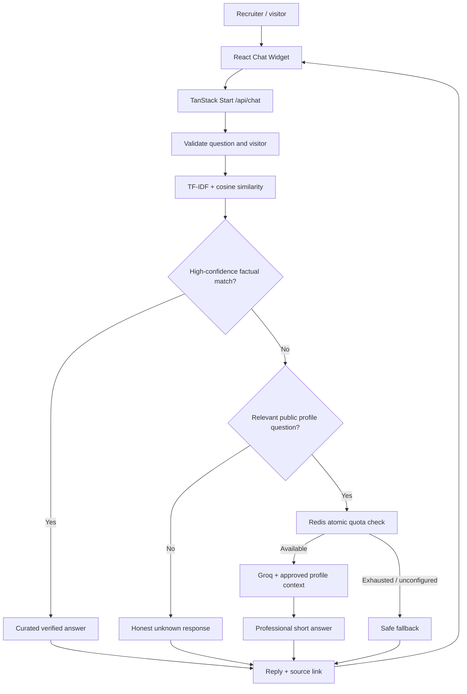

<div align="center">


# AI Engineering Portfolio · Imran AI

**A recruiter-first portfolio with an evidence-grounded personal AI assistant.**

[](https://react.dev/)
[](https://tanstack.com/start)
[](https://www.typescriptlang.org/)
[](https://tailwindcss.com/)


[**Live Portfolio**](https://imranghafoor.vercel.app/) · [**GitHub Profile**](https://github.com/Imran-Ghafoor594) · [**LinkedIn**](https://linkedin.com/in/imranghafoor56)

</div>

---

## The purpose

Recruiters need fast, verifiable answers: **What has Imran built? Which skills does he demonstrate? Where did he study? What did he do during his internships?** The portfolio puts real project case studies first, while an optional assistant surfaces approved facts and links to supporting evidence.

The original cinematic layout, project routes, hero video, visual effects, navigation, and color system are preserved. This repository adds an assistant without replacing the work itself.

## Key features

- **Project-first storytelling** — CropHeat AI, PlantScan, Smart Electricity Consumption and EduPredict, each with a dedicated case-study route.
- **Personal knowledge retrieval** — curated public facts indexed using dependency-free TF-IDF + cosine similarity, with alternative question phrasings.
- **Conditional Groq fallback** — weak or complex relevant queries can be answered by a model supplied with the **approved public profile**. The model is instructed not to invent facts.
- **5 Groq-assisted answers per visitor per rolling 24 hours** — enforced server-side with Redis. Direct, confidently matched answers do not consume the allowance.
- **Delayed circular indicator** — appears after the *third Groq-assisted call*, never on initial chat open.
- **Privacy-first session** — messages live in React memory only and clear on chat close, reload, or route navigation. No conversation database, localStorage, or sessionStorage.
- **Voice controls** — optional browser speech-to-text and read-aloud with a text fallback.
- **Accessible, contained chat UI** — native visible pointer, independent wheel/touch scrolling and isolation from Lenis smooth page scroll.
- **Updated recruiter resume** — three published internships and four key projects; synthetic electricity data described accurately.

## Portfolio projects

| Project | Focus | Case study |
|---|---|---|
| **CropHeat AI** | Explainable deterministic crop heat-risk scoring, FortyGuard, FastAPI, geospatial data | [Read](https://imranghafoor.vercel.app/projects/cropheat-ai) |
| **PlantScan** | Plant disease classification, transfer learning, TensorFlow, Flask | [Read](https://imranghafoor.vercel.app/projects/plantscan) |
| **Smart Electricity Consumption** | Regression, synthetic household energy dataset, Flask | [Read](https://imranghafoor.vercel.app/projects/electricity) |
| **EduPredict** | Academic portal, student/course/result workflows, Flask + MySQL | [Read](https://imranghafoor.vercel.app/projects/edupredict) |

Other builds include Jarvis AI Assistant and RoboImmi.

## System architecture



### How retrieval works

1. Each knowledge entry contains **approved answer text, multiple common questions, a source link and a compact context snippet**.
2. TF-IDF and cosine similarity rank the question examples. A confident, unambiguous match returns the prepared answer immediately and **costs no Groq call**.
3. Weak/ambiguous matches related to Imran may request AI assistance. Groq receives the **approved compact public profile** (not a private file system or unreviewed documents) plus the current question.
4. If the question concerns an unverified personal fact (for example, preferred work city, remote/hybrid preference or a residential address), the assistant **does not guess**. It refers the visitor to direct contact.
5. If the allowance is exhausted, evidence-backed direct answers continue to work.

**Terminology:** This is an *extractive TF-IDF retrieval + conditional LLM fallback* architecture, not an embeddings/vector-database RAG service. Similarity thresholds are heuristic and should be evaluated with real recruiter questions before broad launch.

### 5-call allowance and safeguards

| Action | Groq cost | What is stored |
|---|---|---|
| Strong verified retrieval match | **0** | No chat content |
| Weak/complex relevant question with budget | **1 reservation** | Pseudonymous counter with TTL |
| Unknown/unverified personal fact | **0** | No chat content |
| Limit exhausted | **0** | Counter only |
| Close chat / change page / refresh | **0** | Local messages discarded; quota remains |

Redis uses an atomic Lua script to reserve at most five Groq calls for a signed anonymous visitor ID, expiring after 24 hours from first use. Requests are also throttled per visitor when Redis is configured. A browser clearing cookies may receive a new anonymous identity: **strict person-level enforcement requires login**, which this public portfolio intentionally does not add. Failed upstream calls conservatively count as attempts to discourage retry abuse.

## Stack

| Layer | Technology |
|---|---|
| Framework | React 19, TanStack Start / Router, TypeScript |
| UI | Tailwind CSS 4, Motion, Lenis, Lucide |
| Server API | TanStack Start server routes (`GET` / `POST /api/chat`) |
| Knowledge engine | Local structured TypeScript data + TF-IDF/cosine similarity |
| Model | Groq chat completions (`openai/gpt-oss-20b` by default) |
| Anonymous quota | Upstash Redis REST API and HttpOnly signed cookie |
| Voice | Browser Web Speech API; unsupported browsers use typing |
| Hosting | Vercel-compatible deployment (verify your selected adapter/preset) |

## Repository map

```text
.
├── public/
│   ├── certificates/                # Published supporting certificates
│   ├── resume/Imran Ghafoor.pdf      # Updated, selectable one-page resume
│   └── video/                       # Existing hero video and poster
├── src/
│   ├── components/
│   │   ├── chat/ChatWidget.tsx       # Greeting, messages, voice, circular allowance
│   │   ├── effects/                  # Original portfolio effects
│   │   └── portfolio/               # Original sections and case studies
│   ├── data/                         # Featured projects, experience and links
│   ├── lib/server/
│   │   ├── knowledge.ts              # Approved public knowledge base
│   │   ├── retrieval.ts              # TF-IDF search
│   │   ├── quota.ts                  # Signed visitor and atomic Redis quota
│   │   └── assistant.ts              # Retrieval vs Groq orchestration
│   ├── routes/
│   │   ├── api.chat.ts               # JSON API, no chat persistence
│   │   ├── __root.tsx                # Shared chat widget
│   │   └── projects.*.tsx            # Original case-study routes
│   └── styles.css                    # Original theme + isolated chat fixes
├── .env.example
├── package.json
└── README.md                        # This single project README
```

## Setup from scratch

### Prerequisites

- Node.js **22+** and npm
- Groq account and API key for AI-assisted answers
- Upstash Redis database with REST URL and token for the daily budget
- A long random HMAC secret for the signed visitor cookie

### Local development

```bash
# 1. Install dependencies
npm ci

# 2. Configure secrets (never commit .env)
cp .env.example .env

# 3. Start the application
npm run dev
```

Open the localhost URL printed by Vite. The chat can be opened directly using `/?chat=open`.

### Environment variables

| Variable | Required | Purpose |
|---|---|---|
| `GROQ_API_KEY` | For AI answers | Secret Groq API credential |
| `GROQ_MODEL` | Optional | Defaults to `openai/gpt-oss-20b` |
| `UPSTASH_REDIS_REST_URL` | For AI answers | Upstash HTTPS Redis endpoint |
| `UPSTASH_REDIS_REST_TOKEN` | For AI answers | Secret Redis REST token |
| `CHAT_VISITOR_SECRET` | For AI answers | HMAC signing secret, at least 32 random bytes recommended |

Generate the secret with `openssl rand -hex 32`. Add these variables in your hosting provider's **server-side environment settings**. Never expose them with `VITE_` names and never put them in source control. `.env.example` contains **empty placeholders only**.

**Safe default:** Without all required variables, the portfolio and verified direct retrieval remain available; Groq is disabled rather than running without a quota.

### Deployment checklist

1. Push this clean repository to GitHub (the included ZIP contains no `.git`, `node_modules` or secret `.env`).
2. Import it into Vercel, select the appropriate TanStack Start/Nitro-compatible server runtime, and configure all required environment variables.
3. Build and deploy using the project scripts and the host's supported adapter.
4. Confirm `/api/chat` status returns the expected `aiAvailable` state. Test a direct fact, a complex question, and quota exhaustion.
5. Test desktop wheel scroll, cursor visibility, mobile touch scroll, voice fallback, Escape-to-close, close/reopen privacy and route navigation.
6. Review Groq's data retention controls and enable Zero Data Retention if eligible/required.

### Scripts

```bash
npm run dev       # local server
npm run build     # production build
npm run preview   # preview server
npm run lint      # ESLint
npm run test:assistant  # mocked retrieval and quota tests
```

## Privacy and limitations

- Chat messages exist only in the currently open widget's memory and are cleared on close and navigation. **No conversation content is explicitly written** to browser storage, a database or application logs.
- The backend sends **the current question and approved public profile facts** to Groq when an AI call is needed. Upstream services and hosts may apply their own retention and diagnostic policies. Browser deletion does **not** guarantee deletion from a third-party provider.
- Signed anonymous cookies are for quota tracking only. A Redis key stores a **pseudonymous counter**, not the question, email or name.
- Request abortion on chat close prevents stale UI responses but **cannot guarantee an already-running upstream call stops**.
- TF-IDF can underperform on short queries, typos, multilingual paraphrases and ambiguous questions. Direct responses are conservative, and thresholds should be calibrated with examples.
- Career preferences, relocation, salary expectations and personal residential details are **not verified**; the assistant must not invent them.
- Web Speech Recognition depends on browser support and may use browser-vendor services; it is not guaranteed offline.
- Production behavior, Groq quota enforcement and hosting integration require real credentials and deployment testing; source code alone cannot demonstrate a live API call.

## Responsible content updates

Edit `src/lib/server/knowledge.ts` when education, preferred work city, roles or availability changes. Confirm each entry against Imran's approved resume or portfolio. Include a source URL and alternate ways recruiters may phrase a question. Do **not** insert complete private documents or unapproved home addresses into the context.

## Further improvements

- Measure retrieval recall and false matches against a fixed set of 50–100 recruiter questions.
- Add a consent-based editor workflow for approved career preferences.
- Add optional global account-wide Groq budget alerts and anti-bot controls.
- Consider embeddings only after TF-IDF misses demonstrably justify added complexity.
- Run accessibility/visual regression and performance audits after deployment.

---

<div align="center">

**Built to help people understand the work, not replace the work.**


</div>
